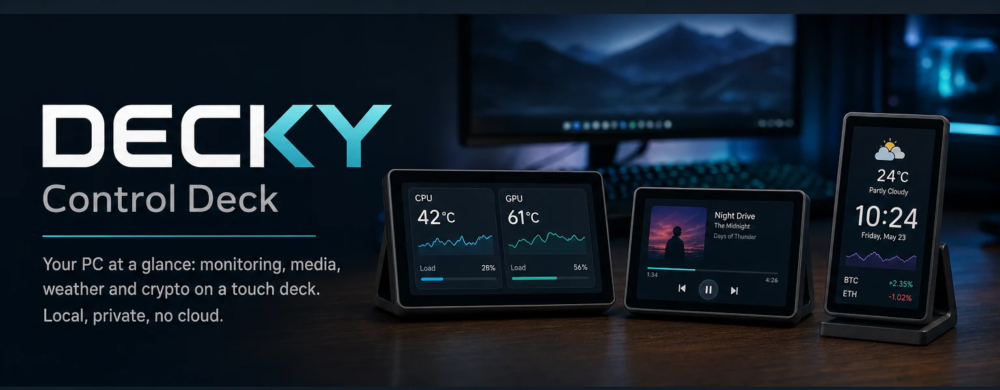
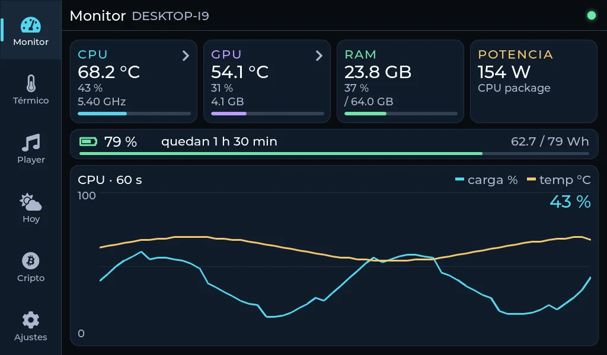
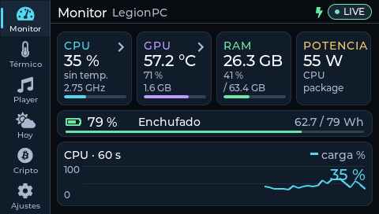
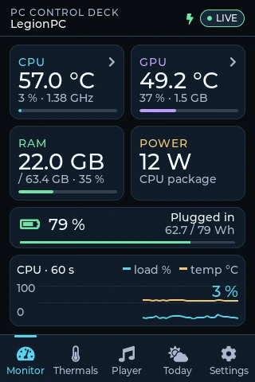
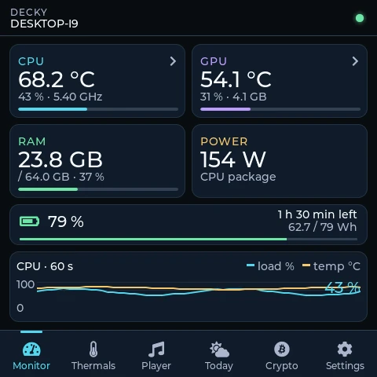

<p align="center"></p>

# DECKY — Control Deck

DECKY turns a small ESP32 touch display into a deck that sits next to your PC: live hardware
telemetry, a media player with album art, a clock with the local weather, a crypto tracker, a
screensaver and quick PC actions. It talks to the PC over your **local network** — no cloud, no
account — and keeps showing the time, the weather and crypto prices when the PC is off. This
repository holds the firmware of every supported deck; the PC side is
**[DECKY Agent](https://github.com/crazyramirez/DECKY-Agent)**, a tray app for Windows, Linux and
macOS. (DECKY was called *PC Control Deck* until firmware 1.0.)

Current version: firmware **1.5.0** ([CHANGELOG](docs/CHANGELOG.md)) · desktop app **DECKY Agent**
([releases](https://github.com/crazyramirez/DECKY-Agent/releases))

## Supported decks

| Deck | Screen | Chip | Layout | Key | |
|---|---|---|---|---|:---:|
| **[Guition JC1060P470C](docs/decks/JC1060P470C.md)** | 7" 1024×600 IPS, landscape | ESP32-P4 + ESP32-C6 for Wi-Fi (ESP-Hosted) | Navigation rail · animated weather on Today | `JC1060P470C` |  |
| **[Guition JC4827W543](docs/decks/JC4827W543.md)** | 4.3" 480×272 IPS, landscape | ESP32-S3 | Navigation rail · sleep button on IO17/IO18 · deep sleep | `JC4827W543` |  |
| **[Guition JC3248W535](docs/decks/JC3248W535.md)** | 3.5" 320×480 IPS, portrait | ESP32-S3 | Bottom tab bar · battery gauge · deep sleep | `JC3248W535` |  |
| **[Guition ESP32-4848S040](docs/decks/ESP32_4848S040.md)** | 4" 480×480 IPS, square | ESP32-S3 | Bottom tab bar · two-column player · USB via CH340 | `ESP32_4848S040` |  |

The key is the deck's name everywhere in this repository: PlatformIO environment, source folder
(`firmware/src/decks/<KEY>`), release file (`pcdeck-<KEY>-<version>…`) and the model the deck
reports on USB. Each deck page has the hardware, the screenshots and everything specific to it.

---

## What the deck does

The same features on every deck; each screen is laid out for its panel (see the deck pages).

- **Monitor** — CPU, GPU, RAM and power cards (temperature, load, clock, VRAM), a laptop-battery
  strip on PCs with a battery, and a 60-second CPU load and temperature chart. Tap CPU or GPU for a
  detail view: model, which sensor feeds the temperature, power and its own 60 s chart. Missing
  values show as `--`, never as `0`.
- **Thermals** — every temperature the PC reports (CPU package, cores, GPU core, GPU memory
  junction, NVMe…) with status OK / HIGH / CRITICAL, and the CPU or GPU 60 s history.
- **Player** — whatever plays on the PC: album art with a background tinted from the cover,
  title and artist, source app, a seekable progress bar, previous / play-pause / next and a volume
  slider that follows your finger. Sites that publish no artwork get a generated cover.
- **Today** — clock (24 h or 12 h) and date, current weather (temperature, max / min, humidity,
  wind, feels-like, sunrise and sunset), the next 6 hours and the next 5 days, over a photograph of
  the current weather by day or by night (*Settings › Time & weather › Weather background*).
  **Up to 6 cities**: swipe sideways and the whole page (clock, date, weather, picture) is the next
  city's, with a dot per city; tap the city for the **Cities** sheet, a world clock with every
  city's local time and weather, where you add (city search on the on-screen keyboard), remove or
  pick the main one. Weather from [Open-Meteo](https://open-meteo.com), every 10 minutes. On the
  7" deck rain, snow and storm flashes are animated over the picture.
- **Crypto** — total market cap, BTC dominance and the Fear & Greed index; up to 12 coins (of 54)
  with logo, rank, 24 h sparkline, live price and change. Tap a coin for its chart: 7 ranges
  (1H…MAX), line or candlesticks, volume, and a finger crosshair to read any point. Currencies:
  USD, EUR, MXN, ARS, COP, BRL. Data from Binance, CoinGecko and alternative.me.
- **Screensaver** (optional) — after 1–30 minutes without a touch: a full-screen wallpaper (eight
  to choose from, fixed, random or rotating with a crossfade), a big clock and the date, and if
  you want them the weather and glass cards with the PC, the song playing and your coins. Tap a
  card to open its page. While it is enabled it replaces auto sleep; the content drifts a few
  pixels every minute against burn-in. **Double-tap the status corner** (battery / LED, top right)
  to start it at once. On a deck running on its battery (JC3248W535), a small battery in the top
  right corner shows the charge, with or without the percentage, or not at all (*Settings ›
  Screensaver › Battery*); on USB it never shows. **Hold a finger on it for 2 s** to put the deck to
  sleep (a ring fills while you hold; lift the finger to cancel).
- **Settings** — Wi-Fi and pairing, the setup assistant, screen off and sleep, lock / restart /
  shut down the PC (restart and shut down only if allowed in DECKY Agent, always confirmed),
  brightness, language (Español / English), refresh rate, screensaver, place, °C / °F, 24 / 12 h,
  coins, currency and chart style, tab order and visibility, thermal alerts, and an About page.
- **Thermal alerts** — when the CPU (≥ 85 °C high, ≥ 95 °C critical) or GPU (≥ 80 / ≥ 90 °C) stays
  hot the deck shows a banner and turns its screen on. Alerts only inform; they never act on the PC.
- **Without a PC** — Today, Crypto and the screensaver work on Wi-Fi alone: the deck then asks
  Open-Meteo, Binance, CoinGecko and alternative.me itself (HTTPS, certificates verified). Monitor,
  Thermals and Player join the tab bar when DECKY Agent connects and leave it when the PC goes
  away.

Where the decks differ:

| | JC1060P470C (7") | JC4827W543 (4.3") | JC3248W535 (3.5") | ESP32-4848S040 (4" square) |
|---|---|---|---|---|
| Navigation | rail on the left | rail on the left | tab bar at the bottom | tab bar at the bottom |
| Today | weather photo, animated rain / snow / storm | weather photo | weather photo, forecast below the clock | weather photo, forecast below the clock |
| Sleep | screen off (no deep sleep on this board) | deep sleep; optional IO17/IO18 button | deep sleep (a tap wakes it) | screen off (no deep sleep on this board) |
| Deck power | charge bolt on USB | charge bolt on USB | battery percentage on its LiPo | — (USB through a CH340) |
| First run | setup assistant | setup assistant | setup wizard (5 steps) | setup wizard (5 steps) |

---

## Getting started

1. **Install DECKY Agent** on the PC — Windows 10/11, Linux (x86_64) or macOS 14+, from the
   [DECKY Agent releases](https://github.com/crazyramirez/DECKY-Agent/releases) (install notes per
   system in [its README](https://github.com/crazyramirez/DECKY-Agent#install)). On Windows the
   installer can start it with Windows (elevated, so CPU temperature can be read) and adds firewall
   rules for **private networks only**.
2. **Flash the deck from the app.** Plug the deck in with a USB **data** cable and use
   **Update deck firmware**: DECKY Agent recognises the deck on USB (its model and firmware), picks
   the right image — on the 7" deck the one for its ESP32-P4 revision — and flashes it. The
   firmware is bundled with the app, so this works offline; when GitHub has a newer release the app
   uses that one. An update keeps Wi-Fi, pairing and settings; a clean install erases them.
3. **Follow the setup assistant.** It opens by itself while no Wi-Fi network is stored (and from
   *Settings › Connection*): language → **Wi-Fi** (pick your network, type the password on the
   on-screen keyboard; hidden networks supported) → **Pair PC** → **city** for the weather. Every
   step can be skipped. The Crypto tab starts with six default coins.
4. **Pair.** In DECKY Agent click **Pair device**: a 6-digit code appears for 2 minutes. On the
   deck choose your PC (found automatically on the network, or type its IP) and enter the code.
   The deck reconnects by itself from then on, even if the PC's IP address changes.

The LED at the top right is **green while DECKY Agent is connected** and grey otherwise (amber with
`DEMO` in demo mode). Tap it while it is grey to jump straight to the fix (Wi-Fi or pairing);
*Settings* shows the details. Double-tap it (or the battery next to it) to start the screensaver
right away, when it is enabled in *Settings › Screensaver*.

**What the PC provides:** CPU / GPU / RAM, temperatures and power from LibreHardwareMonitor on
Windows, hwmon / NVML / amdgpu on Linux, IOKit / SMC on macOS; now playing from the system media
session (Windows), MPRIS (Linux) or Music and Spotify (macOS); volume, lock, restart and shut down.
What a system can't measure is sent as `null` and shown as `--` with a note. Details and
permissions: [DECKY Agent README](https://github.com/crazyramirez/DECKY-Agent).

## Flashing by hand

Each [release](https://github.com/crazyramirez/DECKY-Firmware/releases) carries the images of
every deck; its notes ([`.github/release-notes.md`](.github/release-notes.md)) are the full guide.
Take the files of **your** deck (`X.Y.Z` is the release's version):

| Deck | First install / recovery, at `0x0` | Update, at `0x10000` |
|---|---|---|
| JC1060P470C, ESP32-P4 **v1.x** (every board shipped so far) | `pcdeck-JC1060P470C-X.Y.Z-merged.bin` | `pcdeck-JC1060P470C-X.Y.Z.bin` |
| JC1060P470C, ESP32-P4 **v3.x** | `pcdeck-JC1060P470C_r3-X.Y.Z-merged.bin` | `pcdeck-JC1060P470C_r3-X.Y.Z.bin` |
| JC4827W543 | `pcdeck-JC4827W543-X.Y.Z-merged.bin` | `pcdeck-JC4827W543-X.Y.Z.bin` |
| JC3248W535 | `pcdeck-JC3248W535-X.Y.Z-merged.bin` | `pcdeck-JC3248W535-X.Y.Z.bin` |
| ESP32-4848S040 | `pcdeck-ESP32_4848S040-X.Y.Z-merged.bin` | `pcdeck-ESP32_4848S040-X.Y.Z.bin` |

- The **merged** image (bootloader, partition table and app) goes at **`0x0`**: it erases Wi-Fi,
  pairing and settings, and the setup assistant opens. The **app-only** image goes at
  **`0x10000`** on a deck that already runs DECKY: everything is kept.
- **From the browser:** open [ESP Tool by Espressif](https://espressif.github.io/esptool-js/) in
  Chrome or Edge (it needs Web Serial), **Connect** at 115200 (if it doesn't connect: hold BOOT,
  press and release RST, release BOOT), keep **one row** with the address above — the tool
  pre-fills `0x1000`, which makes the deck reboot in a loop — leave mode / frequency / size at
  `keep`, **Program**, then **Disconnect** and reset the deck.
- **Command line:** `esptool.py --chip esp32s3 write_flash 0x0 pcdeck-JC4827W543-1.0.0-merged.bin`
  (`--chip esp32p4` for the JC1060P470C).
- Deck notes: the JC1060P470C's chip revision is printed when ESP Tool connects
  (`Chip is ESP32-P4 (revision v1.0)`); the JC4827W543 may need to be unplugged and plugged back in
  after flashing. See the deck pages.

Older flashers built on an outdated esptool-js stop with *"Serial data stream stopped"* on the
native USB of these chips: use Espressif's ESP Tool. Only one program can use the port at a time.

## Security and privacy

- With DECKY Agent connected, the deck talks **only to the PC, on the local network**. The firewall
  rules created by the Windows installer apply to *private* networks only.
- Internet requests: the weather (Open-Meteo: the city you search for and the chosen cities'
  coordinates) and crypto data (Binance, CoinGecko, alternative.me: the coin pairs and the currency
  you chose). DECKY Agent makes them while it is connected; without it the deck makes the same
  requests itself, over HTTPS with the server certificates verified. No account, no key, nothing
  about the PC or the user. The deck also asks a public NTP server for the time.
- Pairing uses a **6-digit one-time code** (2 minutes, limited attempts). Each deck then gets its
  own random token; the PC stores only a hash (DPAPI on Windows, an owner-only file on Linux and
  macOS). Unpairing revokes it.
- Commands are validated, de-duplicated and rate-limited; restart and shut down are opt-in and
  confirmed. Wi-Fi passwords, tokens and codes are never logged.
- Telemetry travels over plain `ws://` inside your LAN — see
  [SECURITY.md](https://github.com/crazyramirez/DECKY-Agent/blob/main/docs/SECURITY.md) for the
  threat model and its limits. The deck's Wi-Fi password is stored in flash unencrypted: physical
  access to the deck is access to the Wi-Fi key.

---

## Building from source

The firmware is one PlatformIO project for every deck ([firmware/README.md](firmware/README.md)):
Arduino-ESP32 3.3.5 on ESP-IDF 5.5.1 (pioarduino 55.03.35), LVGL 8.4.0, versions pinned
([ADR 0001](docs/adr/0001-firmware-stack.md)).

| Environment | Builds |
|---|---|
| `JC1060P470C` · `JC1060P470C_r3` | 7" deck, ESP32-P4 v1.x · v3.x |
| `JC4827W543` · `JC3248W535` | 4.3" deck · 3.5" deck |
| `ESP32_4848S040` | 4" square deck |
| `hwtest_<KEY>` | hardware bring-up: colour bars, touch corners, backlight, Wi-Fi scan, heap logs |
| `test` | on-target unit tests of pure logic (alerts, history, protocol), on an ESP32-S3 deck |

```powershell
cd firmware
pio run -e JC4827W543 -t upload            # build and flash one deck (keeps Wi-Fi, pairing, settings)
pio device monitor -e JC4827W543           # serial log and console, 115200
pio run -e hwtest_JC4827W543 -t upload     # hardware test
pio test -e test --upload-port COM6        # unit tests, run on the board
pio run                                    # build every deck (default environments)
```

Or `scripts/flash-firmware.ps1 -Env <environment> [-Port COM6] [-Monitor]` from the repository
root. On Windows run PlatformIO from PowerShell, cmd or VS Code, not Git Bash / MSYS (pioarduino's
toolchain installer refuses MSYS shells).

**Desktop simulator** (no board needed): builds one deck's UI for Windows with zig and renders every
page with sample data to PNG at the deck's resolution.

```powershell
pip install ziglang==0.13.0 pillow
pio pkg install -d firmware -e JC3248W535     # once per deck: LVGL and JPEGDEC sources
python firmware/sim/build.py JC3248W535 en     # -> firmware/sim/out/JC3248W535/en/*.png
python firmware/sim/build.py all               # every deck, Spanish and English
```

Set `PCD_SIM_TIME=<unix seconds>` to pin the clock for reproducible screenshots. On a board,
`python firmware/tools/screenshot.py COM6 shot.png` saves the current screen.

**Generated assets** — the tools in `firmware/tools` all take `--deck <KEY>` or `--deck all` and read
screen size and byte order from the deck's own headers: `gen_fonts.py` (fonts, needs Node.js),
`gen_wallpapers.py` (screensaver wallpapers), `gen_weather_bg.py` (Today backgrounds),
`gen_coins.py` (coin catalog and logos). `gen_weather_images.py` redraws a source weather picture,
and `gen_fixtures.py` embeds the protocol fixtures of DECKY Agent (`shared/fixtures`) into
`firmware/test/test_protocol/fixtures.h` (from a clone next to this repository, looked up as
`../PC-Control-Deck-Agent`, or `--agent <dir>`; `--check` only verifies).

**Continuous integration** ([`.github/workflows/firmware.yml`](.github/workflows/firmware.yml)) —
on every change under `firmware/`: checks the protocol fixtures against DECKY Agent, builds the
four product environments and makes an app image and a merged image of each. A push to `main`
whose `PCD_FW_VERSION` (`firmware/src/core/app/version.h`) has no release yet publishes **one
release with every deck's images**, tag `vX.Y.Z` included (don't push tags by hand); its notes are
the flashing guide followed by that version's CHANGELOG section. Only the latest release is kept.
To release: bump the version, add its `## firmware X.Y.Z` section to the CHANGELOG, push.

## USB serial console

Connect the deck by USB and open `pio device monitor -e <KEY>` (115200). Type `help`:

| Command | Effect |
|---|---|
| `status` | Firmware, link, Wi-Fi, agent, deck power, and the deck's own diagnostics (touch, display, buttons) |
| `id` | `pcdeck board=<KEY> fw=<version>` — how DECKY Agent's USB updater recognises the deck |
| `wifi "<ssid>" <password>` · `wifi reconnect` | Save Wi-Fi credentials (password never echoed) · reconnect to the stored network |
| `agent <host> [port]` · `discover` · `pair <ip> <code> [port]` | Set the PC address · list PCs found by mDNS (`_pcdeck._tcp`) · pair from the console |
| `net clear` | Erase Wi-Fi and pairing data |
| `page <monitor\|thermals\|controls\|today\|crypto\|settings\|wifi\|pair\|cpu\|gpu>` · `scroll <y>` | Navigate (developer aid) |
| `modal paircode\|pairmanual\|wifipass\|place [q]\|cities\|coins` | Open a sheet (developer aid for screenshots) |
| `coin <SYM>` · `coins <BTC,ETH,…>` · `crypto` | Open a coin's chart · set the watched coins · show the crypto data state |
| `tabs <a> <b> <c> <d> <e>` · `tabhide <tab> <0\|1>` | Tab order and visibility (0 Monitor, 1 Thermals, 2 Player, 3 Today, 4 Crypto) |
| `place <lat> <lon> <name>` · `place off` · `weather` | Set / clear the main weather place · show weather and clock state (every city) |
| `city add <lat> <lon> <name>` · `city del <n>` · `city main <n>` · `city show <n>` | More cities for Today: add · remove · make it the main one · show it on Today |
| `screen on\|off` · `saver [now\|off\|bg <n>]` | Screen on / off · show or close the screensaver, pick its wallpaper (0..7) |
| `batlog` | The deck's battery readings over the last ~10 minutes, every 5 s (voltage, USB or battery) |
| `shot` | Screenshot over USB (`firmware/tools/screenshot.py` turns it into a PNG) |
| `demo on\|off` · `nopc 1\|0` | Sample data instead of the PC · ignore the paired PC until reboot (developer aids) |
| `reboot` | Restart the deck |

Deck-only commands: `dbg <grad|art|clip|marquee> <0|1>` (rendering experiments) on the
[JC1060P470C](docs/decks/JC1060P470C.md#usb-console); `sleep` (deep sleep) on the
[JC4827W543](docs/decks/JC4827W543.md#usb-console) and
[JC3248W535](docs/decks/JC3248W535.md#usb-console); `setup [1-5|off]` (setup wizard at a step,
nothing erased) on the JC3248W535 and the [ESP32-4848S040](docs/decks/ESP32_4848S040.md#usb-console)
(console on its CH340 port).

## Troubleshooting

| Symptom | What to check |
|---|---|
| Grey LED, *Settings* shows Wi-Fi *Not connected* | *Settings › Wi-Fi*; the decks join 2.4 GHz networks only |
| Grey LED with Wi-Fi connected | Is DECKY Agent running? Is the PC's network set to **Private**? Same network / VLAN as the deck? |
| Grey LED, and DECKY Agent shows no paired deck | The deck was unpaired on the PC: pair it again |
| CPU temperature shows `--` | Windows: run DECKY Agent elevated (enable *Start with Windows*). Linux / macOS: see the permissions in the [DECKY Agent README](https://github.com/crazyramirez/DECKY-Agent) |
| Restart / Shut down greyed out | Allow shutdown and restart from the device in DECKY Agent |
| Player shows nothing | Nothing is playing in an app that publishes to the system media controls (on macOS only Music and Spotify) |
| Today / Crypto say *Update the PC app* | DECKY Agent is too old: update it |
| *Weather unavailable* or *Prices unavailable* | No internet access (the PC's, or the deck's Wi-Fi without a PC), or a service is rate-limiting; the deck retries by itself |
| Dark screen | Touch it or press BOOT; on the S3 decks it may be in deep sleep (see the deck page) |
| The deck reboots in a loop after flashing from the browser | The merged image went to `0x1000` (the tool's default): flash it again at `0x0` |
| Black screen or a crash right after flashing | The file of another deck: flash the one with your deck's key |
| The serial port repeats `invalid header: 0x04034b50` | A `.zip` was flashed: flash the `.bin` inside it |
| *Serial data stream stopped* in the browser | Use Espressif's ESP Tool; close other programs using the port; enter download mode with BOOT + RST |
| Colours wrong / touch mirrored | Run the deck's `hwtest_<KEY>` environment and see its hardware-validation page |

Deck-specific problems (wrong ESP32-P4 image, sleep button, waking from deep sleep) are on the deck
pages.

---

## Repository layout

```
firmware/
  platformio.ini          one environment per deck (+ JC1060P470C_r3, hwtest_<KEY>, test)
  src/core/               shared by every deck: app logic, network, storage, crypto, alerts, i18n
  src/decks/<KEY>/        one folder per deck: board drivers, deck_config.h / board_pins.h /
                          lv_conf.h, screens laid out for its panel, fonts, embedded images
  include/, boards/, lib/, partitions/   LVGL heap in PSRAM, board files, JD9165 driver, 7" partitions
  sim/                    desktop UI simulator (zig): sim/decks/<KEY>/main.cpp holds the scenes
  tools/                  generators (--deck <KEY>|all), screenshot grabber, fixtures, source images
  test/                   on-target unit tests (pio test -e test)
scripts/flash-firmware.ps1   build, flash and monitor one environment
docs/
  ARCHITECTURE.md, CHANGELOG.md, adr/
  decks/<KEY>.md          one page per deck
  decks/<KEY>/            screenshots, hardware validation, changelog of the 0.x versions
.github/                  CI workflow, release notes template, image scripts
```

## Documentation

- [ARCHITECTURE.md](docs/ARCHITECTURE.md) — core and decks, `deck_config.h`, tasks and data flow
- [CHANGELOG.md](docs/CHANGELOG.md) — release notes (each deck's 0.x history is linked from it)
- Deck pages: [JC1060P470C](docs/decks/JC1060P470C.md) · [JC4827W543](docs/decks/JC4827W543.md) ·
  [JC3248W535](docs/decks/JC3248W535.md) · [ESP32-4848S040](docs/decks/ESP32_4848S040.md)
- Decisions: [0001](docs/adr/0001-firmware-stack.md) firmware stack ·
  [0004](docs/adr/0004-jc4827w543-landscape-crypto.md) JC4827W543, landscape UI, crypto ·
  [0005](docs/adr/0005-jc1060p470c-esp32-p4.md) JC1060P470C, ESP32-P4 ·
  [0006](docs/adr/0006-screensaver.md) screensaver · [0007](docs/adr/0007-without-a-pc.md) without a
  PC · [0008](docs/adr/0008-one-firmware-repository.md) one firmware repository
- [PROTOCOL.md](https://github.com/crazyramirez/DECKY-Agent/blob/main/docs/PROTOCOL.md) — the
  WebSocket protocol between deck and DECKY Agent ·
  [SECURITY.md](https://github.com/crazyramirez/DECKY-Agent/blob/main/docs/SECURITY.md) — threat
  model, pairing, tokens

## Adding a deck

A new deck is a folder `firmware/src/decks/<KEY>/` (start from the deck whose screen is closest),
its environments in `platformio.ini`, an entry in the tools and the simulator, a line in the CI
matrix and in the release notes, and the board in DECKY Agent's USB updater. The step-by-step list
is in [ARCHITECTURE.md › Adding a deck](docs/ARCHITECTURE.md#adding-a-deck).
