# DECKY on the Guition ESP32-4848S040 (4" square)

[← DECKY README](../../README.md) · [JC1060P470C (7")](JC1060P470C.md) · [JC4827W543 (4.3")](JC4827W543.md) ·
[JC3248W535 (3.5")](JC3248W535.md)

A 4" **square** 480×480 panel (the "86 box" wall-switch format) with an ESP32-S3 and a bottom tab bar.
Same features as the other decks (see [What the deck does](../../README.md#what-the-deck-does)),
laid out for the square: same type sizes as the 3.5" deck (both are ~170 dpi), half again as wide.

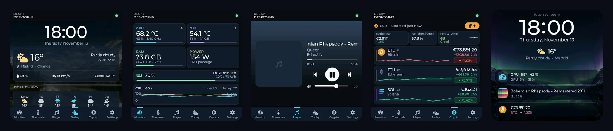

## Hardware

| | |
|---|---|
| Board | Guition ESP32-4848S040 (sold with or without relays: ESP32-4848S040C_I_Y_1 / _3) |
| SoC | ESP32-S3 **N16R8**: 16 MB flash, 8 MB octal PSRAM |
| Wi-Fi | ESP32-S3 built-in, 2.4 GHz |
| Display | 4" 480×480 IPS, ST7701S on the 16-bit parallel RGB bus (RGB565), initialised over 3-wire SPI |
| Touch | capacitive, GT911 over I²C (`0x5D`), no reset / interrupt lines |
| USB | **CH340 USB-UART bridge** on UART0 (a COM port; the S3's own USB pins drive the panel and touch) |
| Buttons | BOOT and RST; BOOT is only for flashing: GPIO0 carries a pixel line while the deck runs |
| Power | USB, no battery |
| Flash layout | `default_16MB.csv`: two 6.25 MB app slots |
| Environments | `ESP32_4848S040`, `hwtest_ESP32_4848S040` |
| Release files | `pcdeck-ESP32_4848S040-<version>[-merged].bin` |

Pins, timings and the panel's init sequence: `firmware/src/decks/ESP32_4848S040/include/board_pins.h`
and `board/lcd_st7701.cpp`. Bring-up record: [hardware-validation.md](ESP32_4848S040/hardware-validation.md).

### How the display is driven

The S3's LCD peripheral scans one 480×480 RGB565 frame buffer in PSRAM continuously (12 MHz pixel
clock, ~43 frames/s). LVGL never draws into it: it draws an area in layers (what lies underneath
first, then the top layer, a keyboard...), and the panel would show those half-drawn layers as
flashes. LVGL draws into its own 480×480 frame (direct mode, PSRAM) and, at the end of each
refresh, the finished areas are copied into the scanned buffer, timed off the scan position (last
VSYNC) so the scan never crosses the copy (no tearing):

- only the refresh's invalid areas are copied (LVGL's direct mode hands the whole display to every
  flush: copying that cost ~28 ms per refresh, whatever had changed);
- when the scan is clear of the changed rows for the whole copy (above them and slower, or below
  them), the copy starts at once; when it is on them, as soon as it has passed them;
- otherwise from the end of a frame: small changes (a key, the clock) finish ahead of the next scan;
  big ones (a page change: ~28 ms for the whole screen, slower than the ~22 ms scan) start once the
  scan has passed their top row, and appear whole on the next frame.

The copy is the CPU's. A DMA copy (GDMA, faster) competes with the panel's own DMA for PSRAM and
starves it: the picture flashes. The driver's double buffering can't be used either: with
`CONFIG_LCD_RGB_RESTART_IN_VSYNC` (set in the Arduino libraries) the S3 restarts the DMA from frame
buffer 0 on every frame.

### Rendering cost

Measured with the console's `bench` (whole-screen redraws; render / wait for the scan / copy):

| Page | 1.2.0 | 1.2.1 |
|---|---|---|
| Settings | 117 ms (73 / 14 / 29) | ~100 ms (64 / 9 / 28) |
| Today, weather picture | 163 ms (121 / 12 / 28) | ~150 ms (110 / 11 / 28) |
| Wi-Fi sheet with its keyboard, over Today | ~215 ms (render 175) | ~115 ms (74 / 12 / 29) |

Most of the render time is the CPU running LVGL (walking the widgets, reading styles, laying out
text), not pixels: a plain full-screen fill takes 4 ms. LVGL's draw loops run from IRAM
(`LV_ATTRIBUTE_FAST_MEM`), and no page is drawn under a full-screen sheet (`ui::skip_covered_screen`,
every deck). Tried without gain: rendering in internal-RAM bands, LVGL's heap in internal RAM, `-O2`.
A bigger CPU cache (`custom_sdkconfig`) needs ESP-IDF to rebuild the Arduino libraries, which fails
on a project path with spaces.

## Screenshots

Rendered by the desktop simulator (`firmware/sim`) with sample data: the board shows the same frames.

| Today | Monitor | Player |
|:---:|:---:|:---:|
| 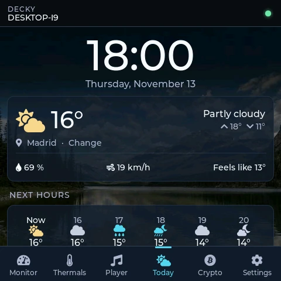 | 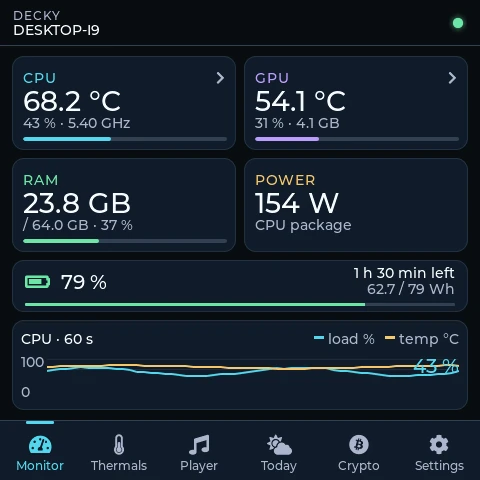 | 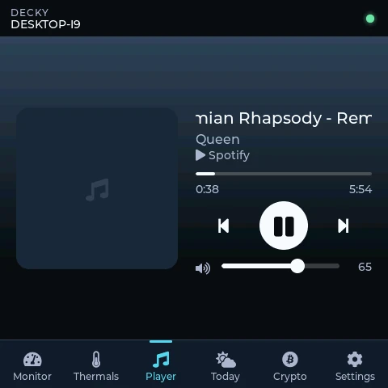 |
| **Crypto** | **Coin** | **Coin · candles** |
| 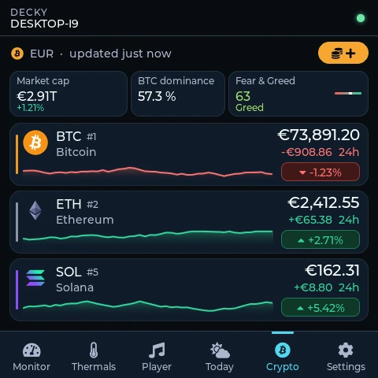 | 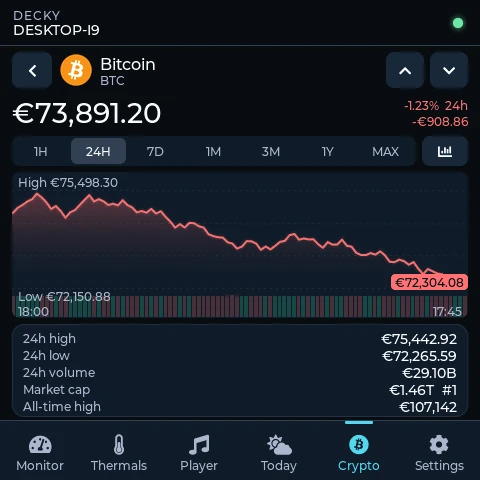 | 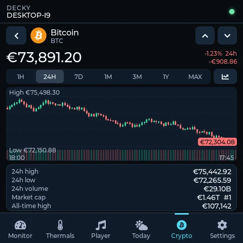 |
| **Thermals** | **CPU detail** | **Settings** |
| 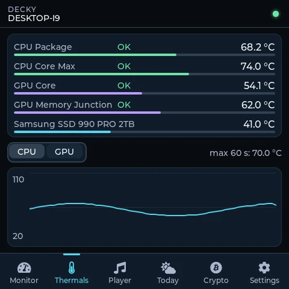 | 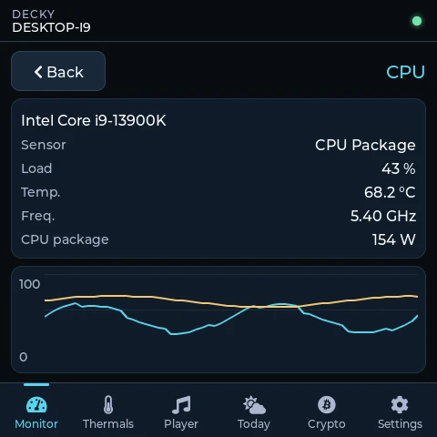 | 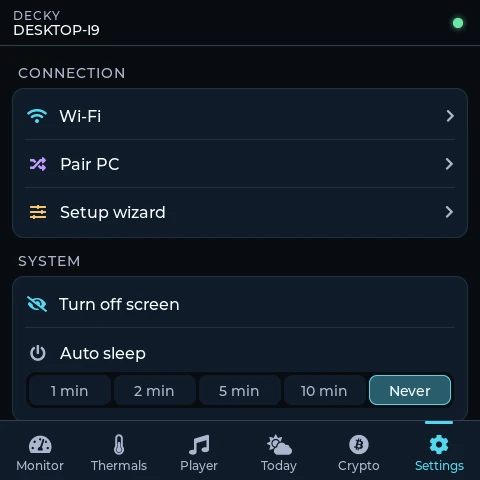 |
| **Screensaver** | **Screensaver · city** | **Coin picker** |
| 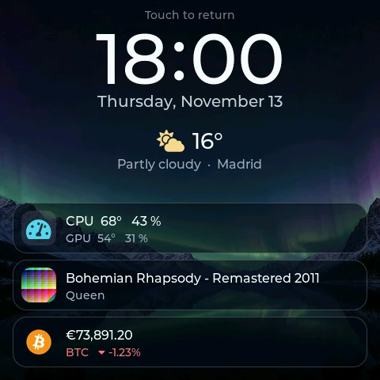 | 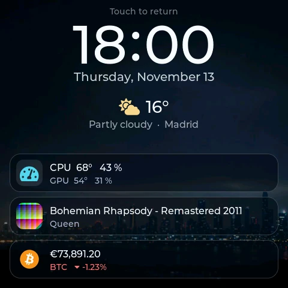 | 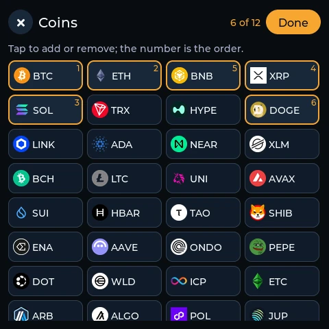 |
| **Setup wizard** | **Pair PC** | **Location search** |
| 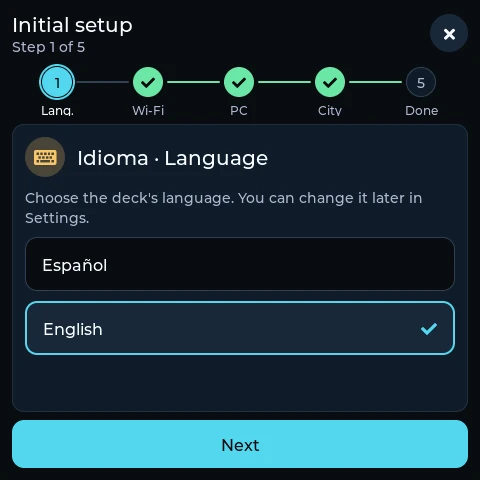 | 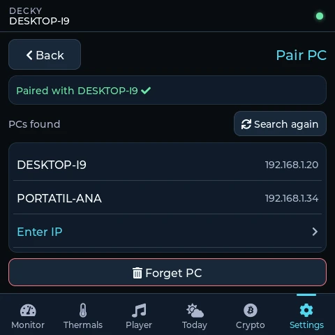 | 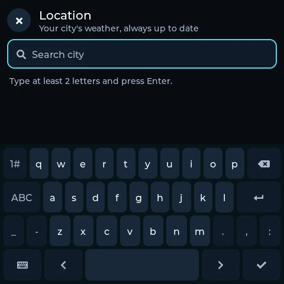 |

## Screen by screen

The pages are the JC3248W535's ([its page](JC3248W535.md#screen-by-screen)) on a wider screen; what
changes:

- **Top bar and bottom tabs** as on the 3.5" deck; the six tabs get 80 px each. The status LED at
  the top right takes a tap (grey: Wi-Fi or pairing) and a **double tap** (the screensaver, when it
  is enabled). No deck power indicator: the board runs on USB and can't tell a PC from a charger
  through its CH340.
- **Monitor:** CPU, GPU, RAM and Power as a 2×2 grid of wide cards, the laptop-battery strip and
  the CPU 60 s chart.
- **Player:** two columns — the cover (200 px, the 150 px image drawn zoomed) on the left; title,
  artist, source, progress, transport and volume on the right, spanning the cover's height.
- **Today:** the clock and date over the weather photo, then the current conditions, the next 6
  hours and the next 5 days (range bars on the week's scale), scrolled.
- **Crypto:** the coin cards in two tiers, with a full-width 24 h sparkline; the coin picker shows
  four coins per row.
- **Screensaver:** clock, date and weather in the upper half of the wallpaper, the PC, music and
  crypto cards stacked below. A touch closes it.

### Settings

| Section | This deck |
|---|---|
| **System — this deck** | **Turn off screen** (any touch turns it back on; that touch doesn't press anything) · **Auto sleep**: screen off after 1 / 2 / 5 / 10 min without a touch, or never (a toast warns 10 s before; replaced by the screensaver while that is on) |

No deep sleep on this board: the touch controller's interrupt line is not wired and BOOT is a
pixel line at run time, so nothing could wake it. The other sections are the same on every deck.

## Setup wizard

The JC3248W535's five steps (language, Wi-Fi, PC, city, done), full width. `setup [1-5|off]` on the
USB console opens it at a step without erasing anything.

## USB console

At **115200** baud on the CH340's COM port (Windows: *USB-SERIAL CH340*). The shared commands are in
the [README](../../README.md#usb-console); `status` adds the touch controller line, and
`setup [1-5|off]` opens the setup wizard. A screenshot (`shot`) is 460 KB: ~40 s at this speed.

## Flashing

DECKY Agent recognises the deck on its CH340 port like any other deck (*Update deck firmware*). By
hand, esptool resets it into the bootloader through the CH340's DTR / RTS lines (no buttons needed).
The CH340 drops bytes above 460800 baud on long reads: uploads are set to 460800.
