# DECKY on the Guition JC3248W535 (3.5")

[← DECKY README](../../README.md) · [JC1060P470C (7")](JC1060P470C.md) · [JC4827W543 (4.3")](JC4827W543.md)

The original deck: a 3.5" portrait panel with an ESP32-S3, a bottom tab bar, deep sleep, a battery
gauge and its own setup wizard. Same features as the other decks (see
[What the deck does](../../README.md#what-the-deck-does)).

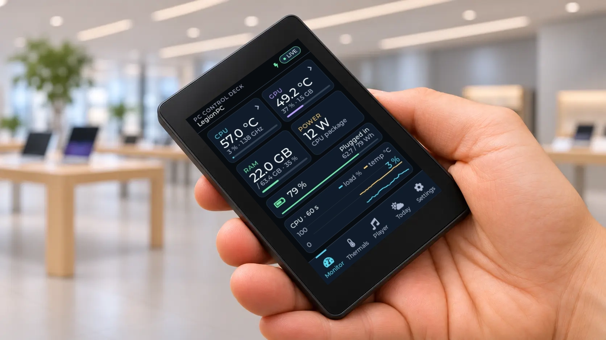

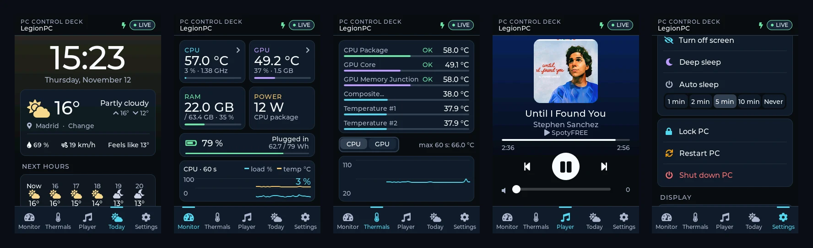

## Hardware

| | |
|---|---|
| Board | Guition JC3248W535 (also sold as JC3248W535EN) |
| SoC | ESP32-S3 **N16R8**: 16 MB flash, 8 MB octal PSRAM |
| Wi-Fi | ESP32-S3 built-in, 2.4 GHz |
| Display | 3.5" 320×480 IPS, portrait, AXS15231B over QSPI |
| Touch | capacitive, the AXS15231B's own touch core (I²C `0x3B`) |
| USB | native USB-Serial/JTAG (a COM port) |
| Buttons | BOOT and RST |
| Battery | optional LiPo; the deck estimates its charge from the cell voltage |
| Flash layout | `default_16MB.csv`: two 6.25 MB app slots |
| Environments | `JC3248W535`, `hwtest_JC3248W535` (the `test` environment builds for this board too) |
| Release files | `pcdeck-JC3248W535-<version>[-merged].bin` |

Pins and driver switches: `firmware/src/decks/JC3248W535/include/board_pins.h`. Bring-up record:
[hardware-validation.md](JC3248W535/hardware-validation.md).

## Screenshots

Real captures from the device (320×480); the screensaver and Crypto images are rendered by the
desktop simulator (`firmware/sim`) with sample data — the board shows the same frames. The device
captures predate the Crypto tab and the new name: the top bar now reads *DECKY* and the tab bar has
Crypto next to Today.

| Today | Today · forecast | Location search |
|:---:|:---:|:---:|
| 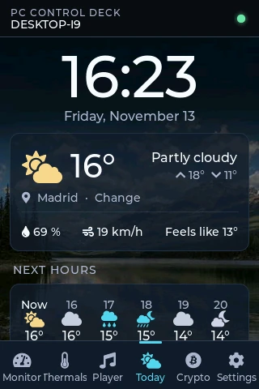 | 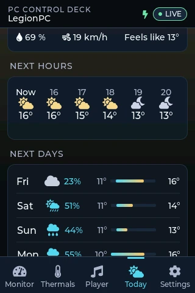 | 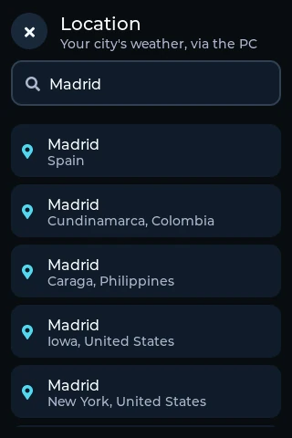 |
| **Monitor** | **CPU detail** | **GPU detail** |
| 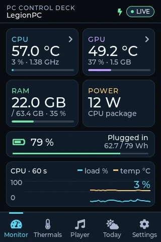 | 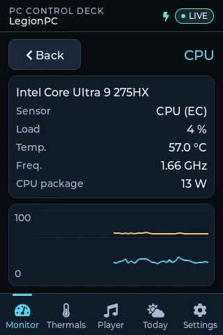 | 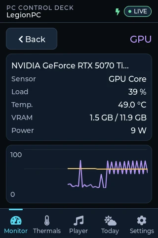 |
| **Thermals** | **Player** | **Crypto** |
| 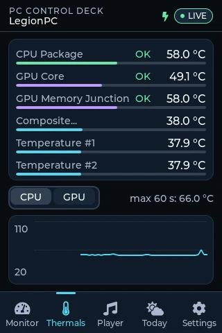 |  | 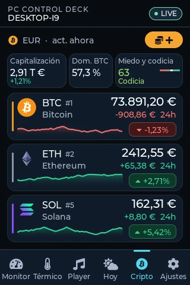 |
| **Settings · System** | **Settings · Display** | **Settings · Time & weather, tabs** |
| 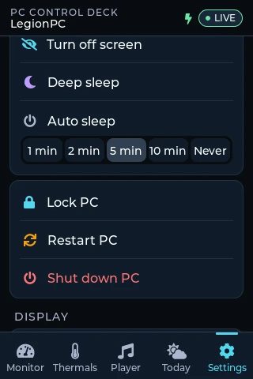 | 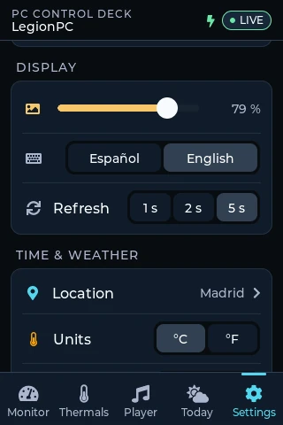 | 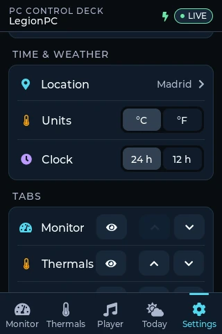 |
| **Pairing code** | **Wi-Fi password** | **Settings · Screensaver** |
| 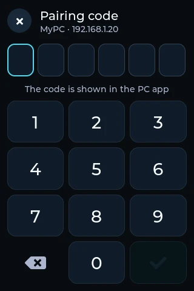 | 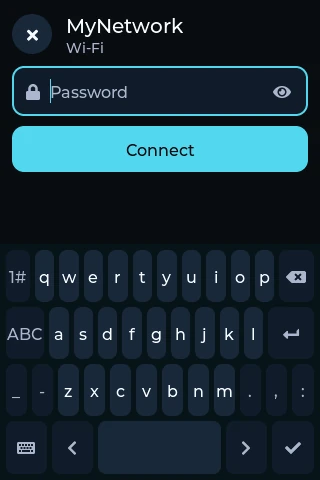 | 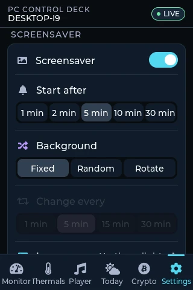 |
| **Screensaver** | **Screensaver · 12 h** | **Screensaver background** |
| 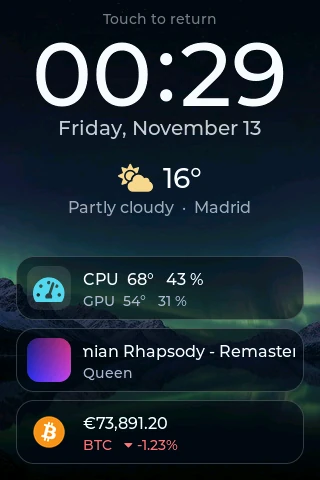 | 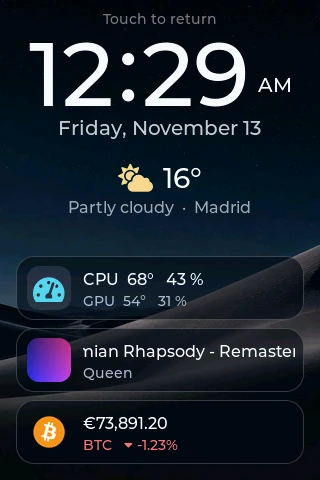 | 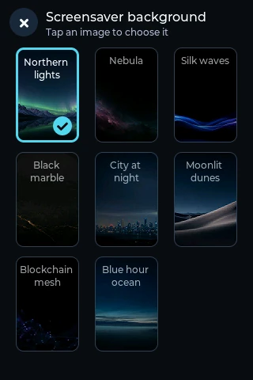 |

## Screen by screen

### Layout

- **Top bar** (always visible): the app title and the **PC name**; the deck battery (a charge bolt
  on USB, battery icon and percentage on the LiPo); the status LED.
- **Bottom tabs:** Monitor · Thermals · Player · Today · Crypto · Settings. Order and visibility of
  the first five: *Settings › Tabs* (▲ ▼ to move, the eye to show or hide); the first visible tab
  opens at power-on. Settings is always shown.

### Today

A glanceable home screen, scrolled vertically: the big clock, the date and the current weather
(condition, temperature, today's max / min, humidity, wind, feels-like) on top; the next 6 hours,
the next 5 days with range bars on the week's scale, and sunrise and sunset below. Over a **photograph of the current weather**
(no animation on this deck; *Settings › Time & weather › Weather background* turns it off and the
page takes a tint from the sky). **Tap the place name to change it.** Units °C / °F (wind in km/h
or mph) and the 24 h / 12 h clock are in *Settings › Time & weather*.

### Monitor, Thermals, Player

- **Monitor:** CPU and GPU cards (temperature, load, clock or VRAM), RAM (used / total), Power (CPU
  package power, or GPU power as a labelled fallback), the laptop-battery strip and the CPU 60 s
  chart. Tap CPU or GPU for the detail view.
- **Thermals:** every temperature with its current value, 60 s maximum and status; a hint explains
  when the CPU temperature needs DECKY Agent to run elevated.
- **Player:** album art, title and artist as a marquee, source app, progress bar to drag, transport
  and volume.

### Crypto

Laid out for the portrait screen:

- **Header:** currency, how old the prices are (*updated 12 s ago*), and a button that opens the
  coin picker.
- **Coin cards in two tiers:** on top the brand-colour accent, logo, symbol with its rank over the
  name, and the live price over its 24 h change; below, a wide 24 h sparkline and the change pill.
- **Coin detail:** drag a finger across the chart to read any point (the price row follows);
  ▲ ▼ (or a swipe left / right) go to the previous / next coin, ◀ back to the list.

### Screensaver

Wallpapers fitted to the portrait screen, big clock and date, the weather line, and the PC, music
and crypto cards **stacked at the bottom**. A touch or **BOOT** closes it, a thermal alert too; tap
a card to go straight to its page. While it is enabled the deck never goes to deep sleep by itself.

### Settings

| Section | This deck |
|---|---|
| **Connection** | Wi-Fi (scans when opened and every 15 s while open) · Pair PC · Setup wizard |
| **System — this deck** | **Turn off screen** (any touch or BOOT turns it back on; that touch doesn't press anything) · **Deep sleep** (low power, Wi-Fi and display off; **one tap on the screen** or BOOT wakes it, in a few seconds) · **Auto sleep**: deep sleep after 1 / 2 / 5 / 10 min without a touch, or never (a toast warns 10 s before; replaced by the screensaver while that is on) |
| **System — the PC** | Lock / Restart / Shut down PC, with confirmation; the PC gives a 10 s warning before restarting or shutting down |
| **About** | includes the deck battery |

The other sections are the same on every deck ([README](../../README.md#what-the-deck-does)).

## Setup wizard

This deck has its own first-run wizard: a full-screen sheet with a five-step stepper, one card per
step and Back / Next at the bottom.

**1 Language → 2 Wi-Fi → 3 Pair PC → 4 Location** (with °C / °F and 24 / 12 h) **→ 5 Done**

It opens at power-on while no Wi-Fi network is stored (not in demo mode) and from *Settings ›
Connection › Setup wizard*. Each step reuses the regular sheets (Wi-Fi password, pairing code,
manual IP, city search), which open above it. Every step can be skipped; nothing in it is required
to use the deck. The console command `setup [1-5|off]` opens it at a step without erasing anything.

## Deck battery and power

- The JC3248W535 has no fuel gauge, so the deck **estimates the charge from the cell voltage**. On
  USB it shows a charge bolt (the voltage then reflects charging, not the remaining charge); on
  battery it shows the percentage. A charge-only wall adapter with a battery attached can't be told
  apart from battery power on this board.
- **Deep sleep** (*Settings › System*, auto sleep or the console `sleep`): Wi-Fi and display off.
  One tap on the screen wakes it (about 3 s to start), or BOOT.
- **BOOT** turns a dark screen back on and closes the screensaver; **RST** restarts the deck.

## Flashing notes

General steps: [Flashing by hand](../../README.md#flashing-by-hand) and the release notes.

- After **Program** and **Disconnect**, press **RST** (or unplug the USB cable and plug it back in)
  to start the new firmware.
- Command line: `esptool.py --chip esp32s3 write_flash 0x0 pcdeck-JC3248W535-<version>-merged.bin`.
- From source: `pio run -e JC3248W535 -t upload` or `scripts/flash-firmware.ps1 -Env JC3248W535`.
  It doesn't touch the settings area.

## USB console

`pio device monitor -e JC3248W535` (115200). Shared commands:
[USB serial console](../../README.md#usb-serial-console).

| This deck | |
|---|---|
| `status` | adds screen state, touch presses and touch-interrupt samples |
| `sleep` | deep sleep (wake: touch or BOOT) |
| `setup [1-5\|off]` | open the setup wizard at that step, or close it; nothing is erased |
| `shot` | 320×480, big-endian RGB565 (`firmware/tools/screenshot.py` handles it) |

## Troubleshooting

| Symptom | What to check |
|---|---|
| The deck doesn't wake from deep sleep | One tap on the screen should do it (it then takes about 3 s to start); otherwise press BOOT (or RST) |
| The deck never goes to deep sleep by itself | The screensaver is on: it replaces auto sleep (*Settings › Screensaver*) |
| Black or garbled screen with a working backlight | Run `hwtest_JC3248W535` and see [hardware-validation.md](JC3248W535/hardware-validation.md) (LCD init table, touch `PCD_TOUCH_*` switches) |

## More

- [ADR 0001](../adr/0001-firmware-stack.md) — the firmware stack, chosen on this board (AXS15231B
  driver, direct mode, LVGL 8.4)
- [hardware-validation.md](JC3248W535/hardware-validation.md) — bring-up record
- [changelog-0.x.md](JC3248W535/changelog-0.x.md) — this deck's history before 1.0
