# DECKY on the Guition JC4827W543 (4.3")

[← DECKY README](../../README.md) · [JC1060P470C (7")](JC1060P470C.md) · [JC3248W535 (3.5")](JC3248W535.md)

A 4.3" landscape deck with an ESP32-S3, a navigation rail, deep sleep and an optional **sleep
button on the IO17/IO18 header**. Same features as the other decks (see
[What the deck does](../../README.md#what-the-deck-does)).

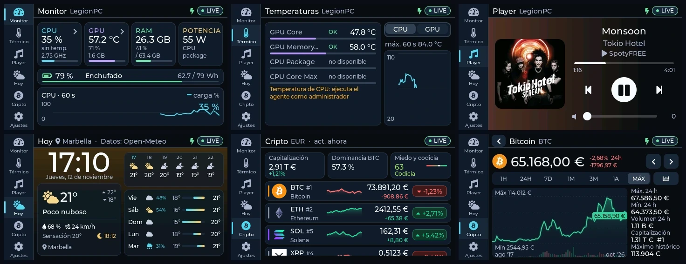

## Hardware

| | |
|---|---|
| Module | ESP32-S3-WROOM-1 **N4R8**: 4 MB flash, 8 MB octal PSRAM |
| Wi-Fi | ESP32-S3 built-in, 2.4 GHz |
| Display | 4.3" 480×272 IPS, NV3041A over QSPI |
| Touch | GT911 capacitive — the **C** variant of the board. The R variant (resistive, XPT2046) is not supported |
| USB | native USB-Serial/JTAG (a COM port) |
| Buttons | BOOT (GPIO0, shared with the panel's TE line) and RST; optional sleep button on IO17/IO18 |
| Battery | LiPo charger on board, but no battery-sense line in the pin map |
| Flash layout | `huge_app.csv`: one 3 MB app slot, no OTA (the vendor firmware's layout) |
| Environments | `JC4827W543`, `hwtest_JC4827W543` |
| Release files | `pcdeck-JC4827W543-<version>[-merged].bin` |

Pins and driver switches: `firmware/src/decks/JC4827W543/include/board_pins.h`. Bring-up record
and checks to run on a new board: [hardware-validation.md](JC4827W543/hardware-validation.md).

## Screenshots

Real captures from the device (480×272, taken over USB with the `shot` console command) connected
to a PC with live data. The screensaver shots are rendered by the desktop simulator
(`firmware/sim`) with sample data; the board shows the same frames.

| Monitor | CPU detail | Thermals |
|:---:|:---:|:---:|
| 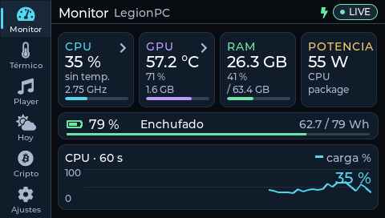 | 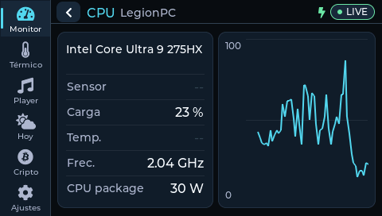 | 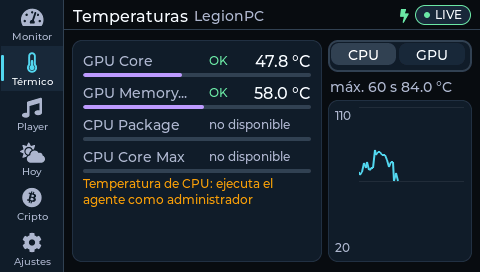 |
| **Player** | **Today** | **Crypto** |
| 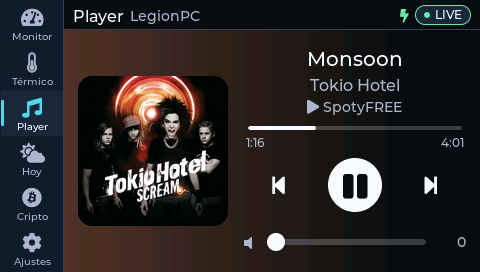 | 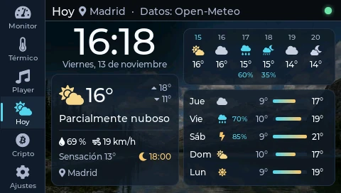 | 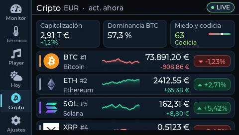 |
| **Coin chart** | **Coins** | **Settings** |
| 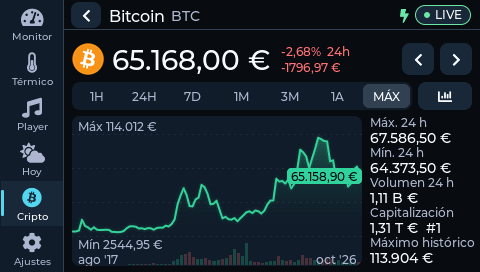 | 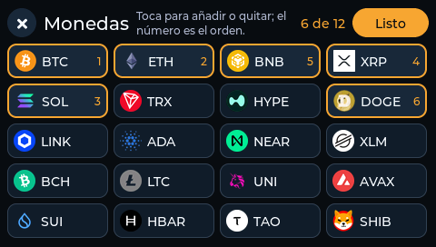 | 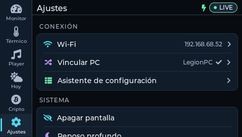 |
| **Settings · System** | **Settings · Crypto** | **City search** |
| 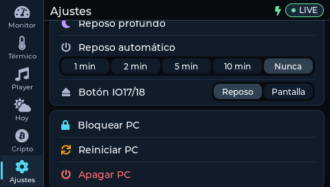 | 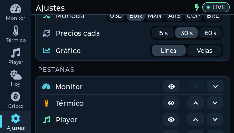 | 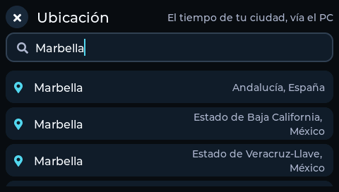 |
| **Wi-Fi** | **Wi-Fi password** | **Pair PC · code** |
| 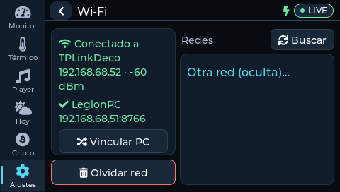 | 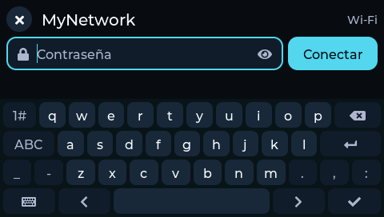 | 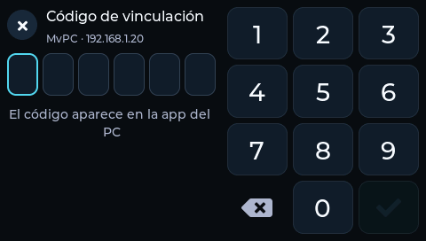 |
| **Pair PC** | **Screensaver** | **Screensaver · 12 h** |
| 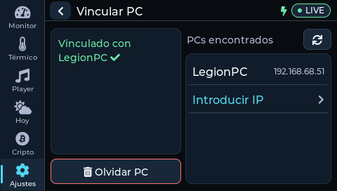 | 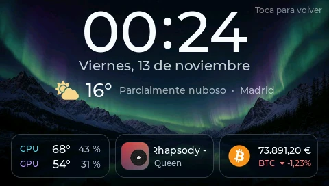 | 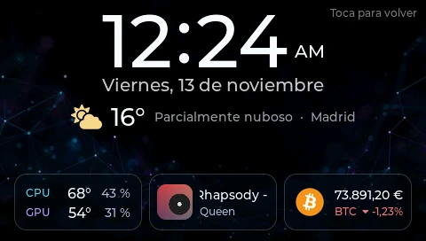 |
| **Screensaver · city** | **Screensaver background** | **Settings · Screensaver** |
| 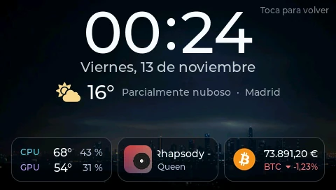 | 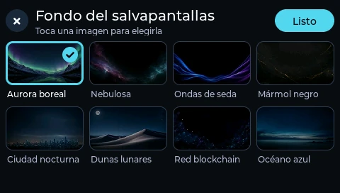 | 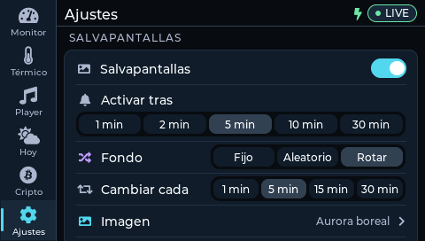 |
| **Settings · Screensaver (2)** | | |
| 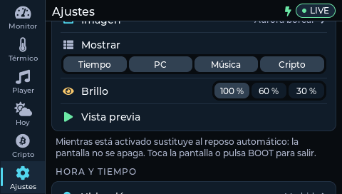 | | |

## Screen by screen

### Layout

- **Navigation rail (left):** Monitor · Thermals · Player · Today · Crypto, then Settings at the
  bottom. Order and visibility of the five tabs: *Settings › Tabs* (▲ ▼ to move, the eye to show
  or hide); the first visible tab opens at power-on.
- **Top bar:** the page title (with a **‹ back** button on sub-pages: CPU / GPU detail, Wi-Fi, Pair
  PC, coin detail), a subtitle (the PC name on the monitoring pages, the place on Today, the
  currency and price age on Crypto), a charge bolt while a USB host is connected, and the status LED.

### Monitor, Thermals, Player

The CPU, GPU, RAM and Power cards in a row, the laptop-battery strip and the CPU 60 s chart.
Thermals: the temperatures with status on the left, the CPU or GPU 60 s history on the right.
Player: album art on the left, title, progress, transport and volume on the right.

### Today

Over a **photograph of the current weather** (no animation on this deck): clock and date; a *Now*
card with the condition, temperature, max / min, humidity, wind, feels-like and the next sunrise
or sunset — **tap it to change the place**; the next 6 hours and the next 5 days.

### Crypto

Coin cards with a brand-colour accent, logo, symbol with rank and name, a 24 h sparkline with glow,
the live price with its 24 h change and a green / red change pill. In the coin detail, drag a
finger across the chart to read any point; swipe left / right (or the arrows) to go through your
coins.

### Screensaver

Wallpaper, big clock and date, the weather line and glass cards (PC, music, crypto). A touch
anywhere else or **BOOT** closes it; a thermal alert closes it too; the **IO17/18 button** closes
it and then does its usual job (deep sleep or screen off). While it is enabled the deck never goes
to deep sleep by itself.

### Settings

| Section | This deck |
|---|---|
| **Connection** | Wi-Fi (scans as soon as the page opens and every 15 s while shown) · Pair PC · Setup assistant |
| **System — this deck** | **Turn off screen** (any touch or BOOT turns it back on; that touch doesn't press anything) · **Deep sleep** · **Auto sleep**: deep sleep after 1 / 2 / 5 / 10 min without a touch, or never (a toast warns 10 s before; replaced by the screensaver while that is on) · **IO17/18 button**: deep sleep or screen off / on |

The other sections are the same on every deck ([README](../../README.md#what-the-deck-does)).
The setup assistant is a sheet with the steps on the left (tap one to jump to it) and the current
step on the right; the Wi-Fi and pairing steps open their own pages and the assistant comes back by
itself once the step is done.

## Sleep button (IO17/IO18)

A touch-button module (TTP223-style, momentary) on the **IO17/IO18 header** turns the deck into a
sleep / wake device:

- **Tap** → deep sleep (Wi-Fi and panel off, minimum power). **Tap again** → the deck wakes up (a
  full restart, a few seconds) and reconnects to the PC by itself.
- *Settings › System › IO17/18 button* switches the action to **screen off / on** instead.
- If the screensaver is showing, a tap closes it and then runs the action.
- **Wiring:** module VCC → 3V3, GND → GND, OUT → IO17 or IO18 (both are watched). The firmware
  learns each line's idle level at boot (pull-down, so an unconnected pin never fires) and treats
  the opposite level as a press, so active-high modules (the TTP223 default) and active-low buttons
  both work. Use the module in **momentary** mode, not toggle.
- In deep sleep the wake sources are chosen from the idle levels at that moment: the button, the
  touch screen and, when possible, BOOT. The touch screen still wakes the deck when no button is
  fitted.

## Buttons and power

- **BOOT** turns a dark screen back on and closes the screensaver. **RST** restarts the deck.
- **Deep sleep** (*Settings › System*, auto sleep, the IO17/18 button or the console `sleep`):
  wake it with the sleep button, a touch on the screen or BOOT.
- **Deck power:** the board charges a LiPo but has no battery-sense line, so the deck only shows a
  charge bolt while a USB host is connected. With a 2:1 divider from the battery to a free ADC pin,
  set `PCD_PIN_BAT_ADC` in `firmware/src/decks/JC4827W543/include/board_pins.h` to get the
  percentage.

## Flashing notes

General steps: [Flashing by hand](../../README.md#flashing-by-hand) and the release notes.

- After **Program** and **Disconnect**, **unplug the USB cable and plug it back in**. On this board
  GPIO0 (the BOOT strap) is shared with the panel's TE line, so after a reset from the flasher the
  deck can stay in download mode with a black screen until it is power-cycled. (PlatformIO uploads
  avoid this: they restart the deck with a watchdog reset, which doesn't re-sample the straps.)
- Command line: `esptool.py --chip esp32s3 write_flash 0x0 pcdeck-JC4827W543-<version>-merged.bin`.
- From source: `pio run -e JC4827W543 -t upload` or `scripts/flash-firmware.ps1 -Env JC4827W543`.
  It doesn't touch the settings area.

## USB console

`pio device monitor -e JC4827W543` (115200). Shared commands:
[USB serial console](../../README.md#usb-serial-console).

| This deck | |
|---|---|
| `status` | adds GT911 address and statistics, frame push time, touch presses, the sleep button's pins with their idle levels, taps seen and action, and the last wake reason |
| `sleep` | deep sleep (wake: sleep button, touch or BOOT) |
| `shot` | 480×272, big-endian RGB565 (`firmware/tools/screenshot.py` handles it) |

## Troubleshooting

| Symptom | What to check |
|---|---|
| The IO17/18 button does nothing | `status` on the console shows each pin's idle level and the taps seen; use momentary (not toggle) mode |
| The deck doesn't wake from deep sleep | Tap the IO17/18 button or the screen; otherwise press RST |
| Black screen right after flashing | Unplug the USB cable and plug it back in (GPIO0 / panel TE, see [Flashing notes](#flashing-notes)) |
| Colours inverted / touch mirrored | Run `hwtest_JC4827W543` and see [hardware-validation.md](JC4827W543/hardware-validation.md) (`PCD_TOUCH_*` switches) |

## More

- [ADR 0004](../adr/0004-jc4827w543-landscape-crypto.md) — the port to this board: landscape UI,
  Crypto tab, sleep button
- [hardware-validation.md](JC4827W543/hardware-validation.md) — bring-up checklist
- [changelog-0.x.md](JC4827W543/changelog-0.x.md) — this deck's history before 1.0
